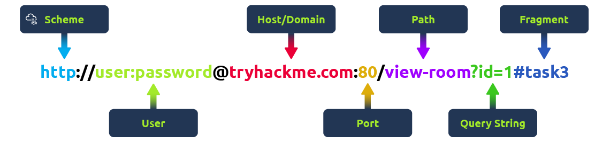

# Web Application Basics

### Overview

Websites consists of:
1. Front End:
- **HTML (Hypertext Markup Language)** - instructs the browser on what to display and how
- **CSS (Cascading Style Sheets)** - visual style: defines colours, fonts, layouts, and appearance.
- **JS (JavaScript)** - enables complex activity, choices, and decisions in the browser

2. Back End
- **Database** - Stores, modifies, and retrieves information
- **Infrastructure** - - Underlying hardware and software supporting the app, including web/application servers, storage, and networking devices
- **WAF (Web Application Firewall)** - filters out dangerous requests to protect the web server

---
### URL

**URL (Uniform Resource Locator)** - web address that guides your browser to a specific online resource  



| Element          | Description                                                                                  |
| ---------------- | -------------------------------------------------------------------------------------------- |
| **Scheme**       | Explains how to access the site. Mostly **HTTP** or **HTTPS**                                |
| **User**         | Optional username included for sites requiring authentication                                |
| **Host/Domain**  | Name identifying the specific website                                                        |
| **Port**         | Directs the browser to the correct service/doorway on the server                             |
| **Path**         | Points to the exact file, folder, or page on the server                                      |
| **Query String** | Starts with a question mark (**?**) and passes data like search terms or form inputs         |
| **Fragment**     | Starts with a hash symbol (**#**) and jumps directly to a specific section/heading on a page |

---

### HTTP
HTTP messages are packets of data exchanged between a user (the client) and the web server.

There are two types of HTTP messages:
- **HTTP Requests**: Sent by the user to trigger actions on the web application.
- **HTTP Responses**: Sent by the server in response to the user’s request.

HTTP Request example:
```text
POST /login HTTP/1.1
Host: tryhackme.com
Content-Type: application/x-www-form-urlencoded
Content-Length: 43

username=aleksandra&password=securepassword
```

HTTP Response example:
```text
HTTP/1.1 200 OK
Content-Type: application/json
Content-Length: 56
Date: Wed, 29 Aug 2024 12:00:00 GMT

{
  "message": "Login successful!",
  "status": "success"
}

```

Each message follows format:
1. Start Line - tells you what kind of message is being sent (**POST, GET, PUT**, etc.)
2. Headers - key-value pairs in HTTP messages that provide **extra information** and instructions
to both clients and servers
3. Empty Line - divider that separates the header from the body
4. Body - place where the actual data is stored

==To be honest, these notes aren't very helpful. It would be better to go to TryHackMe and read through the material again==

---
### HTTP Requests
Format:  
`METHOD /path HTTP/version`

Contains:
- **HTTP Method** → action the client wants to perform.
- **URL Path** → identifies the requested resource.
- **HTTP Version** → protocol version being used.

HTTP Methods:
- **GET** → retrieves data. Avoid sensitive information in URLs.
- **POST** → sends data to create/update something. Validate input to prevent SQLi/XSS.
- **PUT** → replaces/updates a resource. Requires authorisation.
- **DELETE** → removes a resource. Requires authorisation.
- **PATCH** → partially updates a resource; validate input.
- **HEAD** → like GET, but returns only headers.
- **OPTIONS** → shows available HTTP methods.
- **TRACE** → debugging method; often disabled for security.
- **CONNECT** → establishes a connection, commonly for HTTPS.

HTTP Versions:
- **HTTP/0.9 (1991)** → GET only.
- **HTTP/1.0 (1996)** → introduced headers and better content handling.
- **HTTP/1.1 (1997)** → persistent connections, chunked transfer, improved caching.
- **HTTP/2 (2015)** → multiplexing, header compression, prioritisation.
- **HTTP/3 (2022)** → uses **QUIC**, improving speed and security.
- HTTP/1.1 is still widely supported.

Common formats:
- **URL Encoded** → `key=value&key2=value2`
- **Form Data (`multipart/form-data`)** → supports multiple data blocks and file uploads.
- **JSON** → data stored as name/value pairs inside `{ }`.
- **XML** → data stored using nested opening/closing tags.

---

### HTTP Responses

Status Line includes:
1. **HTTP Version**
2. **Status Code** → 3-digit result of the request.
3. **Reason Phrase** → human-readable explanation.

#### Status Code Categories:

|Code|Meaning|
|---|---|
|**100–199**|Informational|
|**200–299**|Successful|
|**300–399**|Redirection|
|**400–499**|Client errors|
|**500–599**|Server errors|

#### Common Status Codes:
- **100 Continue** → server is ready for the rest of the request.
- **200 OK** → request was successful.
- **301 Moved Permanently** → resource moved permanently to a new URL.
- **404 Not Found** → requested resource doesn't exist.
- **500 Internal Server Error** → server encountered an error.

**Response Headers:**
- **Response headers** = key-value pairs sent by the server with an HTTP response.
- Tell the client/browser how to handle the response.

**Important headers:**
- **Date** → date and time when the response was generated.
- **Content-Type** → type of content (HTML, JSON, etc.) + character set.
- **Server** → identifies server software (e.g. nginx); can reveal information useful to attackers.

**Other Common Headers:**
- **Set-Cookie** → sends cookies to the client.
    - `HttpOnly` → prevents JavaScript access.
    - `Secure` → cookie is sent only over HTTPS.
- **Cache-Control** → controls how long/how the response is cached.
- **Location** → specifies the destination for redirects (3xx).
    - Improper validation can cause **Open Redirect** vulnerabilities.

**Response Body:**
- Contains the actual data returned by the server:
    - HTML
    - JSON
    - images, etc.

---
### Security Headers

### Content-Security-Policy (CSP)

- Helps mitigate **XSS** by controlling which sources can load content/scripts.
- Common directives:
    - **`default-src`** → default allowed sources.
    - **`script-src`** → allowed sources for JavaScript.
    - **`style-src`** → allowed sources for CSS.
    - **`'self'`** → current website's own domain.

Example:  
`Content-Security-Policy: default-src 'self'; script-src 'self' https://cdn.example.com`

### Strict-Transport-Security (HSTS)

- Forces browsers to use **HTTPS** instead of HTTP.
- Directives:
    - **`max-age`** → how long HSTS is enforced (seconds).
    - **`includeSubDomains`** → applies to subdomains.
    - **`preload`** → allows inclusion in browser preload lists.

### X-Content-Type-Options

- Prevents browsers from guessing the MIME type.
- `nosniff` → browser uses the declared `Content-Type` only.

### Referrer-Policy

Controls how much referrer information is shared when navigating to another site.

- **`no-referrer`** → sends no referrer information.
- **`same-origin`** → sends referrer only to the same origin.
- **`strict-origin`** → sends only the origin when using the same secure protocol.
- **`strict-origin-when-cross-origin`** → sends more information for same-origin requests, but only the origin for cross-origin requests.