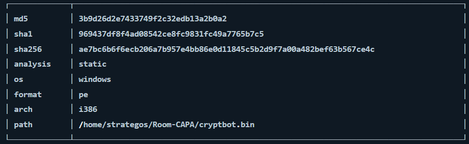
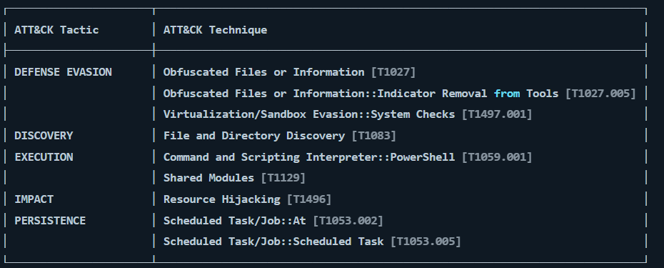
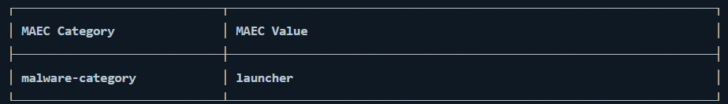
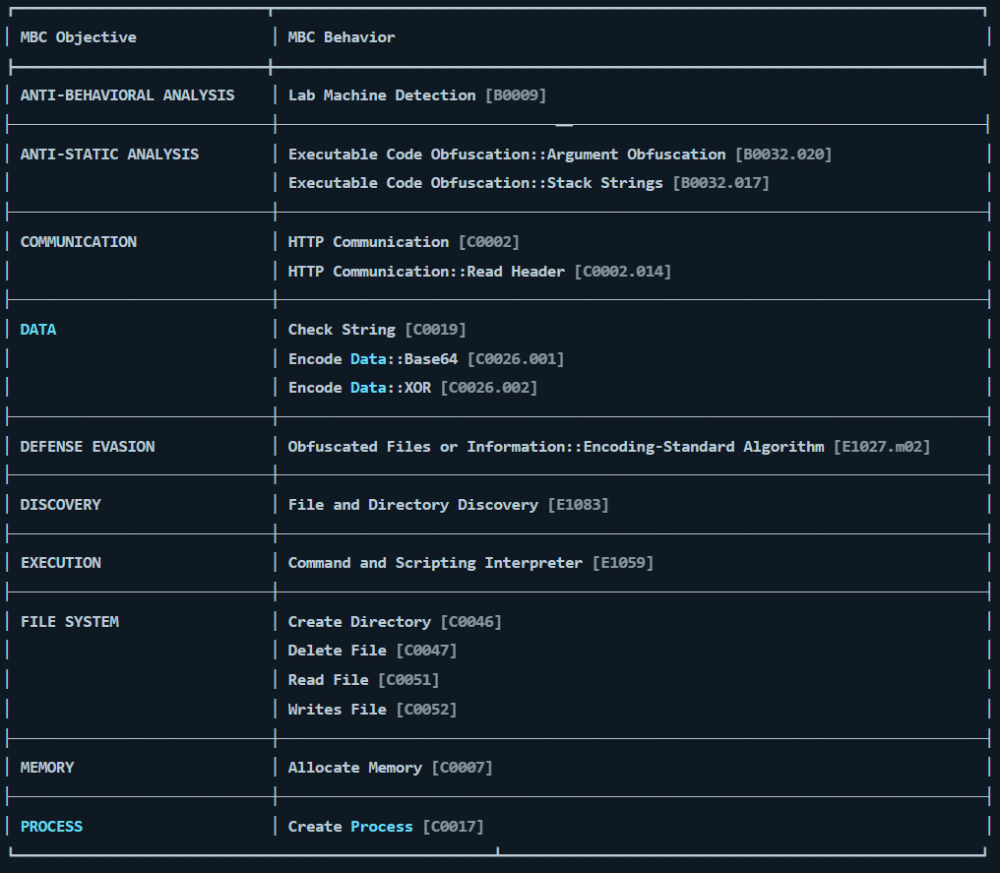
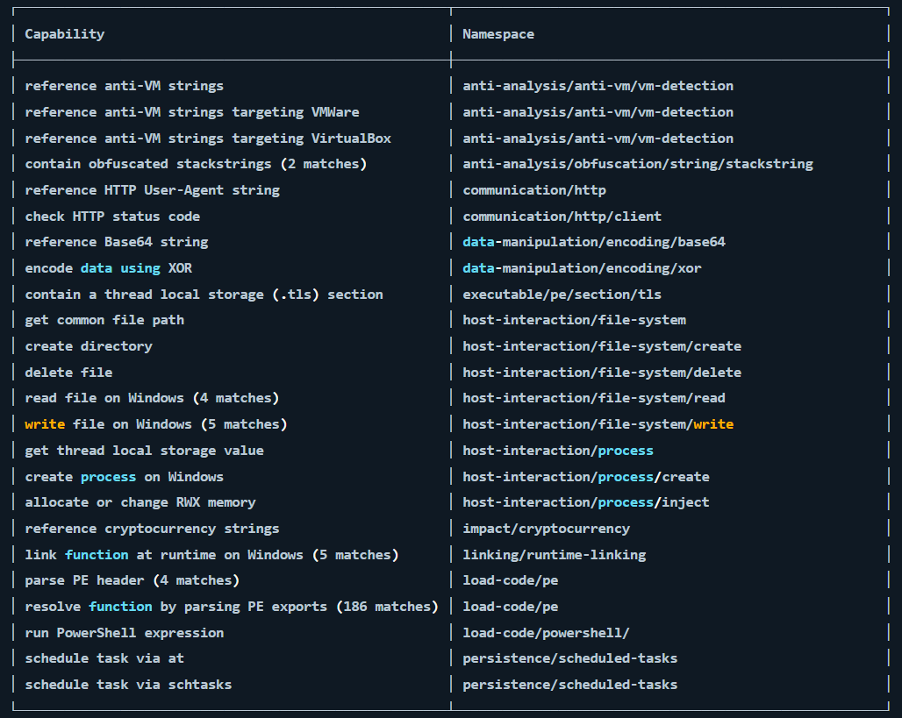

# CAPA The Basics

### Basics

**CAPA (Common Analysis Platform for Artifacts)** - tool designed to **identify the capabilities** present in executable files (binares, etc.). Describes common behaviours, allowing it to determine what the program is capable of doing

> To run CAPA type: `capa.exe` followed by binary: `capa.exze .\cryptbot.bin`

> There is also available CAPA Web Explorer

|Option|Description|Sample Syntax|
|---|---|---|
|`-h` or `--help`|Show this help message and exit.|`capa -h`|
|`-v` or `--verbose`|Enable verbose result document.|`capa.exe .\cryptbot.bin -v`|
|`-vv` or `--vverbose`|Enable a very verbose result document.|`capa.exe .\cryptbot.bin -vv`|

---
### CAPA Results

#### First block:

- The cryptographic algorithms, such as the `md5`, and `sha1/256`.
- The `analysis` field tells us how CAPA performed its analysis on the file.
- The `os` field reveals the operating system (OS) context for which the identified capabilities apply.
- The `arch` field allows us to determine whether we are dealing with a binary related to x86 architecture.
- The `path` where the analyzed file was located.

#### Second Block:

**MITRE ATT&CK** (Adversarial Tactics, Techniques, and Common Knowledge) framework - global knowledge repository that documents the tactics and techniques employed by threat actors at every stage of a cyber-attack.

#### Third Block:

Here can be:
1. Launcher - Performs actions that are typical for malware
2. Downloader - Downloads and runs other files, often used by more complex malware

#### Fourth Block:

**MBC (Malware Behavior Catalogue)** - catalogue of malware objectives and behaviours

Behaviour format:
`OBJECTIVE::Behavior::Method[Identifier]` or  `OBJECTIVE::Behavior::[Identifier]`

#### Fifth Block:

rule format: `text Capability(Rule Name)::TLN(Top-Level Namespace)/Namespace`
